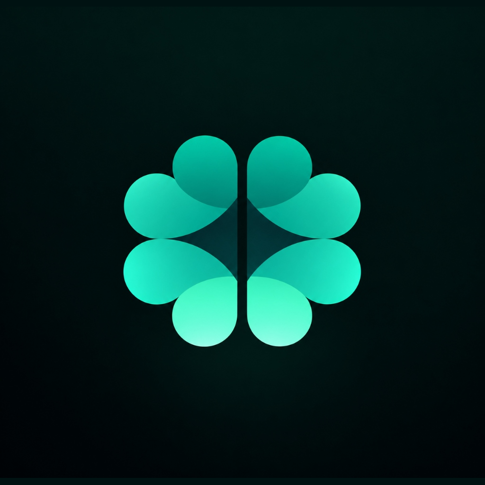
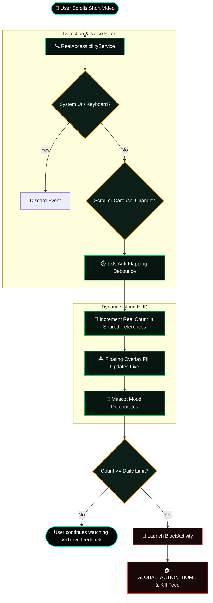

<p align="center">
  
</p>

<h1 align="center">
  <b>Un<span style="color:#00F5C4;">plug</span></b>
</h1>

<p align="center">
  <b>Stop Doomscrolling. Count Every Reel. Reclaim Your Mind.</b><br>
  <sub>A mindful, privacy-first Android counter and real-time blocker for Instagram Reels, YouTube Shorts, Facebook & Snapchat.</sub>
</p>

<p align="center">
  
  
  
  
  
</p>

---

### 🎨 The Big Picture (Mental Model)

```
        ╔══════════════════════════════════════════════════════════════════════╗
        ║                        YOUR DAILY ATTENTION                          ║
        ╚══════════════════════════════════════════════════════════════════════╝
                                           │
                                    [ Open Phone ]
                                           │
                 ┌─────────────────────────┴─────────────────────────┐
                 ▼                                                   ▼
       ┌───────────────────┐                               ┌───────────────────┐
       │   Productive /    │                               │  DOOMSCROLLING    │
       │   Intentional     │                               │  Shorts / Reels   │
       └───────────────────┘                               └───────────────────┘
                 │                                                   │
                 │                                                   ▼
                 │                                    ┌─────────────────────────────┐
                 │                                    │  ⚡ ReelAccessibilityService │
                 │                                    │  • Detects scroll events    │
                 │                                    │  • Smart 1.0s debounce      │
                 │                                    └──────────────┬──────────────┘
                 │                                                   │
                 │                                                   ▼
                 │                                    ┌─────────────────────────────┐
                 │                                    │ 🏝️ Dynamic Island Pill      │
                 │                                    │   [ 🧠 24 reels • Fresh ]   │
                 │                                    └──────────────┬──────────────┘
                 │                                                   │
                 │                                         Reels >= Daily Limit?
                 │                                         ┌─────────┴─────────┐
                 │                                         ▼                   ▼
                 │                                      [ NO ]               [ YES ]
                 │                                         │                   │
                 │                                   Keep Watching      🚨 Feed Blocker!
                 │                                   (Live Warning)     (Back to Home)
                 │                                                             │
                 └─────────────────────────┬───────────────────────────────────┘
                                           ▼
                                 🌱 Mind Restored!
```

---

## ⚡ How It Works (Event Flow)



---

## 🧠 Brain State Deterioration Model

Every reel consumed triggers cognitive fatigue. Unplug visualizes this in real-time right above your feed:

```
 Reel Range      Brain State           Status Indicator        What Happens to Your Focus
 ──────────────────────────────────────────────────────────────────────────────────────────
   0 - 25        🟢 Healthy & Happy    ● Fresh Brain           Laser focus, clear thoughts
  26 - 50        🟡 Slightly Tired     ● Working Hard          Mild cognitive drag
  51 - 100       🟠 Exhausted          ● Overheating           Brain fog, passive scrolling
 101 - 150       🟣 Unhealthy & Sick   ● Glitching             Dopamine loop fatigue trap
 151+            🔴 Rotting / Emergency● CRITICAL LOCKOUT      🚨 HARD FEED BLOCK TRIGGERED!
```

---

## 📱 Architecture & System Design

```
 doomscroll/
 ├── 📄 index.html                     # Apple Glassmorphism Landing Page
 ├── 📦 unplug.apk                     # Signed, Production-Ready APK (v1.0)
 ├── 📁 static/                        # Logos, Petal Emblems, Transparent Mascots
 └── 📁 android/                       # Native Android Project
     └── 📁 app/src/main/
         ├── 📄 AndroidManifest.xml   # Permissions: Accessibility & System Alert Window
         ├── 📁 java/com/brainunplug/app/
         │   ├── 📱 MainActivity.kt             # Glassmorphic Apple Health Dashboard
         │   ├── 🛑 BlockActivity.kt            # Fullscreen Feed Interceptor
         │   ├── ⚙️ service/
         │   │   ├── 👁️ ReelAccessibilityService.kt # ViewPager2 & Scroll Event Sniffer
         │   │   └── 🏝️ FloatingOverlayService.kt    # Draggable Dynamic Island HUD
         │   ├── 📊 model/BrainState.kt         # Cognitive fatigue calculation
         │   └── 💾 util/PreferenceManager.kt   # Midnight auto-reset & streak engine
         └── 📁 res/
             ├── 🎨 drawable/                   # Frosted glass shapes & glowing borders
             ├── 📱 layout/                     # activity_main.xml, overlay_counter.xml
             ├── 🖼️ mipmap-*/                   # 8-Petal Clover App Icon (All Densities)
             └── 🌈 values/colors.xml           # Obsidian Emerald & Radiant Mint
```

---

## 🎯 Supported Apps & Detection Hooks

| Platform | Detection Mechanism | Event Hook | Target Package |
| :--- | :--- | :--- | :--- |
| **Instagram** | Vertical RecyclerView / Carousel | `TYPE_VIEW_SCROLLED` | `com.instagram.android` |
| **Instagram Lite** | Feed Scroll Monitor | `TYPE_VIEW_SCROLLED` | `com.instagram.lite` |
| **YouTube Shorts** | ViewPager2 Carousel Index | `TYPE_VIEW_SELECTED` | `com.google.android.youtube` |
| **Facebook** | Reels Video Player | `TYPE_VIEW_SCROLLED` | `com.facebook.katana` |
| **Facebook Lite** | Feed Video Scroll | `TYPE_VIEW_SCROLLED` | `com.facebook.lite` |
| **Snapchat** | Spotlight Vertical Pager | `TYPE_VIEW_SCROLLED` | `com.snapchat.android` |

---

## 🛠️ Security, System UI & OEM Compatibility

```
  ┌────────────────────────────────────────────────────────┐
  │  Realme / Oppo / Vivo / Xiaomi / Samsung Compatibility │
  ├────────────────────────────────────────────────────────┤
  │                                                        │
  │   [ Incoming Accessibility Event ]                     │
  │              │                                         │
  │              ▼                                         │
  │   Is package:                                          │
  │   • com.android.systemui        ──▶ ❌ DISCARD (Ignored)│
  │   • com.google.android.inputmethod ──▶ ❌ DISCARD     │
  │   • com.coloros.gamespace       ──▶ ❌ DISCARD         │
  │   • com.oplus.cosa              ──▶ ❌ DISCARD         │
  │              │                                         │
  │              ▼                                         │
  │   [ Valid Short Video Event ]                          │
  │              │                                         │
  │              ▼                                         │
  │   ✅ Update HUD Floating Pill (Never Flickers or Vanishes)
  └────────────────────────────────────────────────────────┘
```

- **100% On-Device & Private**: Does not record screen, does not read chat messages, does not track video titles.
- **Battery Efficient**: Idle listener with event-driven hooks (0% background CPU drain).
- **OEM Hardened**: Immune to aggressive Chinese OEM background service killers (ColorOS, MIUI, FuntouchOS).

---

## 📥 Download & Installation

### Option 1: Direct Cloud Download (Gofile)
👉 **[Download Unplug APK (v1.0)](https://gofile.io/d/bjurcgSf)**

### Option 2: Local Wi-Fi Fast Download
If phone and computer share the same Wi-Fi:
```
http://192.168.31.79:8080/unplug.apk
```

### Option 3: ADB Direct Install (Developers)
```bash
adb install -r unplug.apk
```

---

## 🚀 Building from Source

```bash
# Clone the repository
git clone https://github.com/rg-ui/unplug.git
cd unplug/android

# Compile debug or release build
./gradlew assembleRelease

# The signed APK will be generated at:
# app/build/outputs/apk/release/app-release.apk
```

---

<p align="center">
  <b>Unplug from the scroll. Reclaim your focus.</b><br>
  <sub>Crafted with 💚 by <a href="https://github.com/rg-ui">Ravi Gupta</a></sub>
</p>